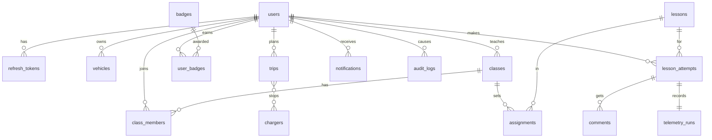

# Volt Academy: architecture

## Layout
apps/web (React, Vite, R3F) | apps/api (Express, Prisma) | packages/sim (physics, scoring, coach) | packages/shared (Zod schemas, types)

## Data access
The web app talks to one `VoltApi` interface. `RealApi` calls `/api/v1`. `DemoApi` uses IndexedDB with seeded data. `VITE_API_MODE` picks one at build time, so GitHub Pages works with no server.

## ER diagram

## API groups (/api/v1)
Errors: `{ error: { code, message, details?, requestId? } }`. Lists: `?page=&pageSize=` returning `{ items, page, pageSize, total }`.

| Group | Routes |
|---|---|
| auth | POST register, login, logout, refresh, forgot, reset, verify |
| users | GET/PATCH me; GET/PATCH me/settings |
| vehicles | CRUD /vehicles |
| lessons | GET /lessons, /lessons/:slug |
| attempts | POST /attempts, GET /attempts, GET /attempts/:id |
| telemetry | PUT /attempts/:id/telemetry, GET /attempts/:id/telemetry, GET /lessons/:slug/ghost |
| trips | POST /trips/plan, CRUD /trips |
| chargers | GET /chargers?bbox= |
| classes | CRUD /classes, POST /classes/join, GET /classes/:id/analytics |
| assignments | POST/GET /classes/:id/assignments |
| comments | POST/GET /attempts/:id/comments |
| admin | users, lessons CRUD, audit-logs |
| analytics | GET /analytics/me, /analytics/platform |

Roles: LEARNER, INSTRUCTOR (own classes only), ADMIN (all).

## Telemetry storage
Runs are stored as one row with parallel Float32 arrays packed into a gzip'd JSON blob (about 30 KB for 10 min at 10 Hz), plus indexed summary columns on `lesson_attempts`.
